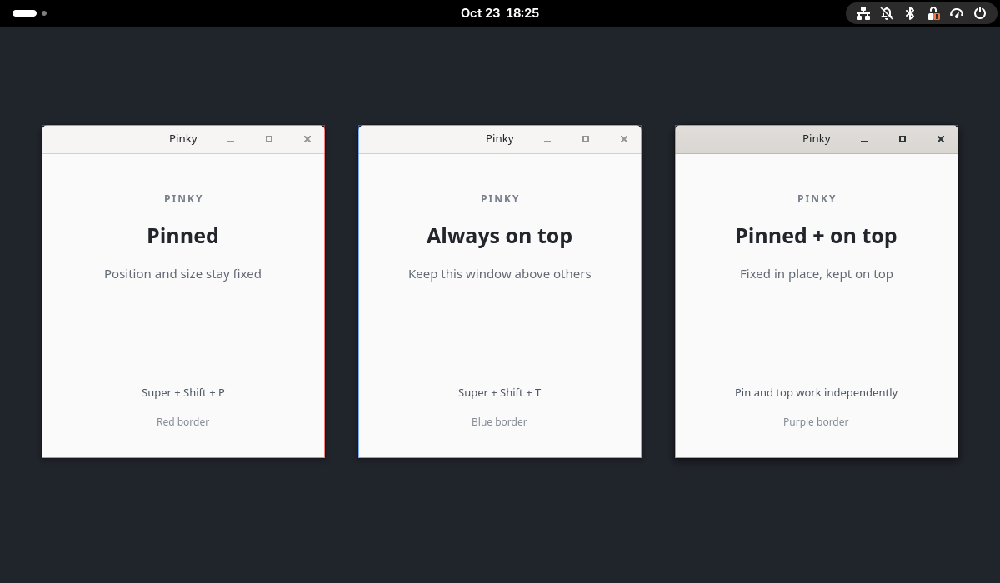

# Pinky

Pinky is a small GNOME Shell 50–51 / Wayland extension for keeping reference windows in place or visible above other windows. Geometry pinning and always-on-top are independent controls.

Version 0.1.0 is the initial preview release. GNOME 50 is the minimum version: Pinky uses window size-limit APIs introduced in Mutter 50 to release pins when application constraints change.



## Use

| Shortcut | Action |
|---|---|
| `Super+Shift+P` | Toggle geometry pin on the focused window |
| `Super+Shift+T` | Toggle always-on-top on the focused window |
| `Super+Shift+U` | Unpin every pinned window; leave always-on-top unchanged |

Holding a shortcut acts once. A 1px inset border at 65% opacity shows the state: **red** for pinned, **blue** for always-on-top, **purple** for both. Changes through the Shell's window menu update the border too. The border follows the window's stacking and visibility, including when maximized or fullscreen.

### What pinning preserves

- **Floating windows:** keep the current frame rectangle.
- **Side-tiled or single-axis-maximized windows:** become floating at the same rectangle. Unpinning leaves them floating; it does not rebuild the previous tiling relationship.
- **Maximized windows:** keep their rectangle and maximized state.
- **Fullscreen windows:** can be pinned, but entering or leaving fullscreen releases the pin. This preserves Mutter's original restore size.

Pinky cancels interactive moves and resizes through Mutter's Escape handler and restores pinned geometry and maximization after other attempts to change them. Closing, minimizing and changing workspaces remain available. Unpinning stops enforcement without moving the window.

Application size limits and display layout take precedence over a pin:

- If new minimum/maximum sizes no longer permit the saved rectangle, Pinky unpins that window and notifies you. You can pin its new size again. Size hints follow Mutter's rules: fullscreen ignores them, and maximized windows ignore maximum sizes.
- Changing display layout, resolution or scale releases all pins with a notification, so Mutter can place windows in the new layout. Adding or changing a panel or dock releases pins only where the available work area changed.

Disabling the extension also releases pins, including on screen lock. Always-on-top is Mutter state and remains unchanged by all these releases.

### Adjust the border

Appearance changes apply immediately to existing borders. Configure them with GSettings; there is no preferences UI.

| Setting | Values |
|---|---|
| `border-width` | 1–8 CSS pixels; default 1 |
| `border-opacity` | 0.0–1.0; default 0.65. Zero hides borders without unpinning or changing always-on-top. |
| `pin-color`, `above-color`, `both-color` | `#rrggbb` colors for the three states |

For example, make the border fainter or use a muted orange for pinned windows:

```bash
schema="${XDG_DATA_HOME:-$HOME/.local/share}/gnome-shell/extensions/pinky@xwilludelu.github.io/schemas"
gsettings --schemadir "$schema" set org.gnome.shell.extensions.pinky border-opacity 0.45
gsettings --schemadir "$schema" set org.gnome.shell.extensions.pinky pin-color "'#d08770'"
```

Use `gsettings --schemadir "$schema" reset org.gnome.shell.extensions.pinky border-opacity` to restore the default opacity. Other appearance keys can be reset the same way.

### Change shortcuts

Set `pin-key`, `above-key` or `unpin-all-key` with GSettings, for example:

```bash
schema="${XDG_DATA_HOME:-$HOME/.local/share}/gnome-shell/extensions/pinky@xwilludelu.github.io/schemas"
gsettings --schemadir "$schema" \
  set org.gnome.shell.extensions.pinky pin-key "['<Super><Shift>p']"
```

## Install or update

If you previously installed the local version, run `gnome-extensions disable pinky@local` first. Existing shortcut and border settings are retained. After enabling and checking the new version, you can uninstall `pinky@local`.

Build the installation ZIP from the repository root. This needs `gnome-extensions` and `glib-compile-schemas`:

```bash
mkdir -p extras/pinky/dist
gnome-extensions pack --force --extra-source=LICENSE \
  --out-dir=extras/pinky/dist extras/pinky
```

Install it with:

```bash
gnome-extensions install --force \
  extras/pinky/dist/pinky@xwilludelu.github.io.shell-extension.zip
```

Log out and back in to discover a new installation or load updated code, then enable it:

```bash
gnome-extensions enable pinky@xwilludelu.github.io
gnome-extensions info pinky@xwilludelu.github.io
```

The extension should report `State: ACTIVE`.

## Verify behavior

The opt-in integration test needs GNOME Shell 50 or 51, Python 3 with PyGObject, GTK4 and GdkPixbuf typelibs, `dbus-run-session`, and the packaging tools above:

```bash
bash extras/pinky/tests/run.sh
# Or verify a specific release ZIP:
bash extras/pinky/tests/run.sh extras/pinky/dist/pinky@xwilludelu.github.io.shell-extension.zip
```

The test installs the ZIP unchanged into a temporary home, then starts a headless compositor on a private session bus with in-memory settings. It does not change the installed extension or the running desktop. Real GTK4 Wayland windows, keyboard/titlebar/edge input and screenshot pixels check pinning, held shortcuts, border appearance (including mixed-scale monitors, 150% logical and 200% physical scaling), size limits, fullscreen transitions, display/work area changes and disable/enable cleanup.

Release verification passed on GNOME Shell/Mutter 50.5, 51.0 and 51.1. Additional checks on 50.5 covered Chrome and Qt Wayland windows, XWayland windows, minimizing, workspace changes, and moving windows between monitors with different scales.

## License and feedback

The files in `extras/pinky` are licensed under [GPL-3.0-or-later](LICENSE): GNU GPL version 3 or, at your option, any later version. This license applies to Pinky, not to the rest of the setup repository.

Report bugs in the repository's [issue tracker](https://github.com/XWIlluDelu/my-linux-setup/issues), including the Pinky version, GNOME Shell version, affected application, display scale and steps to reproduce.
